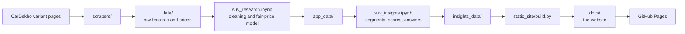

# SUV Insights: Indian SUVs, ranked with reasons

An end-to-end data project. I collected data on every SUV variant sold in India, cleaned it, built a model that estimates what each variant *should* cost for its features, and used the result to answer the questions buyers actually ask. The answers are published as a static website, and every answer says **why**.

- **Coverage:** 1,399 SUV variants of 136 models from 25 brands, from ₹5.69 lakh to ₹4.90 crore.
- **Prices:** ex-showroom and on-road prices in New Delhi, collected from CarDekho on 20 Nov 2026.
- **Live site:** _link to be added once GitHub Pages is switched on_ (it will be at `https://soumadittya.github.io/suv-sales-analysis/`).
- **Built with:** Python, pandas, scikit-learn, statsmodels, Jinja2, HTML and CSS, GitHub Pages.

## Why this project

A buyer with a budget of ₹10–15 lakh can choose from 346 SUV variants. CarDekho lists about 130 features for a typical variant, and trims of the same model differ in small ways. The questions that matter are hard to answer by reading spec sheets:

- Which variants give the most for the money at my budget, and which give the least?
- Which are the safest, or the best equipped?
- At what price do automatic gearboxes, ADAS or 4x4 start?
- Which brand gives the best value for a 7-seater?

This project answers 26 such questions for every price segment and every brand, and 8 about the whole market, and backs every answer with the numbers behind it.

## What the website shows

The site has three tabs and a method page.

| Tab | What it shows |
|---|---|
| **Segments** | 7 price segments (under ₹10 lakh up to above ₹1 crore). Each has its average price and standard deviation, its cars and variants, and answers to 26 questions. |
| **Brands** | 25 brands. Each has its models (with each model's average price and standard deviation), its variants, and answers to the same 26 questions. |
| **Overall** | 8 questions about the whole market, such as where each type of automatic gearbox starts and which brand has the best-value 7-seaters. |
| **Method** | How every score and ranking is worked out, so readers can judge the reasons for themselves. |

The 26 questions are grouped into categories: value for money, features, modern features against engine strength, safety, ADAS, the top and bottom of the price range, gearbox type, seats, 4x4 and AWD, and engine size. Each category is a collapsed section that opens on a click.

An example answer, the best value for money under ₹10 lakh:

> **1. Tata Punch Adventure Turbo**, ₹8.47 lakh, 29% below fair price.
> ₹8.47 lakh is 29% below its fair price of ₹11.97 lakh, so you save about ₹3.50 lakh on what these features usually cost. It has ADAS, a 5-star Bharat NCAP rating and 6 airbags.

## Some findings

All prices are New Delhi ex-showroom prices listed on 20 Nov 2026.

| Segment | Variants | Average price | Standard deviation | Best value for money |
|---|---:|---:|---:|---|
| Under ₹10 lakh | 185 | ₹8.71 lakh | ₹1.06 lakh | Tata Punch Adventure Turbo: ₹8.47 lakh, 29% below fair price |
| ₹10–15 lakh | 346 | ₹12.66 lakh | ₹1.37 lakh | Mahindra Scorpio N Z2 Petrol MT: ₹13.69 lakh, 26% below |
| ₹15–20 lakh | 363 | ₹17.70 lakh | ₹1.50 lakh | Renault Duster Adventure 1.3 Turbo DCT: ₹15.39 lakh, 20% below |
| ₹20–30 lakh | 283 | ₹23.69 lakh | ₹2.39 lakh | Tata Harrier EV Fearless Plus QWD 75: ₹26.79 lakh, 35% below |
| ₹30–50 lakh | 79 | ₹38.15 lakh | ₹5.54 lakh | Tata Harrier EV Empowered QWD 75 Stealth: ₹30.04 lakh, 28% below |
| ₹50 lakh–1 crore | 51 | ₹70.46 lakh | ₹14.51 lakh | Volvo XC90 B5 AWD: ₹97.80 lakh, 41% below |
| Above ₹1 crore | 92 | ₹2.09 crore | ₹95.40 lakh | BMW X7 xDrive40i M Sport Signature: ₹1.26 crore, 41% below |

- **Automatic gearboxes start below ₹10 lakh.** A torque-converter automatic starts at ₹9.29 lakh (Skoda Kylaq Classic Plus AT), a CVT at ₹9.30 lakh (Nissan Magnite Acenta Turbo CVT), and a dual-clutch (DCT) at ₹10.00 lakh (Kia Sonet HTK (O) Turbo DCT).
- **ADAS starts at ₹7.77 lakh**, with the Tata Punch Adventure. 15 of the Punch's 26 variants have it.
- **4x4 starts at ₹12.59 lakh**, with the Maruti Suzuki Jimny Zeta.
- **Best value by brand:** for 5-seaters, Renault (its 39 five-seat variants average 13% below their fair prices); for 7-seaters, Mercedes-Benz (its 6 seven-seat variants average 19% below).
- **Where the price model and the market disagree most:** limited editions and imported SUVs come out far above their fair prices, while many luxury SUVs assembled in India come out well below. The model doesn't know about import duty or local assembly, which is a known limit.

## How it works



### 1. Collecting the data: `scrapers/`

Two scrapers written with the Python standard library only (`urllib`, `html.parser`, threads):
- `new_variant_features_scraper.py` saves every feature of every variant, one CSV file per variant: 1,399 files with about 183,000 feature rows in total.
- `new_variant_prices_scraper.py` saves each variant's ex-showroom and on-road price breakdown for New Delhi.

### 2. Cleaning and the fair-price model: `notebooks/suv_research.ipynb`

The notebook shows how each data problem was found and why each fix was chosen.
- **Loading and joining.** It found and fixed problems such as Mercedes-Benz variant names ("200", "300") being read as numbers, duplicated feature rows, and a placeholder price.
- **Cleaning.** CarDekho uses 309 feature names; names that mean the same thing are merged, text values such as engine capacity and screen size become numbers, and an unlisted feature is treated as *unknown*, never as "doesn't have it". The result is one row per variant: 1,399 rows and 232 columns.
- **Exploration.** How prices spread, price by brand, which features are reliably listed, and which ones move together.
- **The fair-price model.** A Lasso regression predicts the log of the ex-showroom price from 54 feature columns (power, size, gearbox, fuel, safety and comfort equipment) plus brand information. It was tested with 5-fold cross-validation that keeps all variants of a model in the same fold, so every estimate comes from a model that never saw that car or its siblings.

  | Model | Typical error |
  |---|---:|
  | Baseline: power, fuel, seats and brand | 16.9% |
  | All features, plain regression | 12.6% |
  | All features, Lasso | 9.0% |
  | Gradient boosting | 8.7% |
  | **Final: Lasso with a luxury flag, and brand effects only for brands with 4+ models** | **8.2%** |

  The final model is within ±20% of the real price for 89% of variants. A variant more than 15% below its fair price is labelled **Good value** (113 variants), more than 15% above is **Overpriced** (191), and the rest are **Fair** (1,091). 4 variants list too few features for a fair price.
- **Further research** for the first version of the app: trim ladders (which trim of a model gives the most for its price), a must-have feature finder, feature bundles found with association rules, and the limits of the data. Its outputs are also in `app_data/`.

### 3. Answering the questions: `notebooks/suv_insights.ipynb`

- **Price segments.** Each variant goes into a segment by its own price, so a model whose trims span two bands appears in both. The top band was split at ₹1 crore, because a single "₹50 lakh and above" band put ₹50 lakh SUVs next to ₹4.9 crore ones.
- **Scores**, each compared within the segment or brand being ranked:

  | Score | How it is worked out |
  |---|---|
  | Value for money | How far the price is below or above the fair price |
  | Features | 1 point for each of 29 comfort and technology features, minus 2 for each of 9 basics the car is confirmed to lack |
  | Modern features | How many of 13 eye-catching features it has, such as a panoramic sunroof or ambient lighting |
  | Engine | The average of its power and torque percentiles |
  | Safety | Safety equipment out of 100 (airbags, ESC, ADAS, tyre pressure monitor and more), plus or minus points for a Bharat NCAP or Global NCAP rating |

- **Rules for fairness.** A missing listing never costs a car points. When fewer cars qualify than a question asks for, only the best one is shown, with a note saying why.
- **Output.** 60 questions with 3,464 answer rows (1,014 for segments, 2,388 for brands, 62 overall), each with a reason. Before saving the CSV files, the notebook checks that every question is answered in every group and that ranks have no gaps, and it re-checks each segment's top value pick with a direct calculation.

### 4. The website: `static_site/` and `docs/`

`static_site/build.py` fills Jinja2 templates with the CSV files in `insights_data/` and writes 36 static HTML pages to `docs/`. Nothing is calculated while people browse, so the site needs no server or database, and GitHub Pages serves it for free. The pages work on phones, follow the device's light or dark mode, and have one small script, which opens a collapsed section when a link points into it.

## Repository layout

```
data/              raw CarDekho data from scraping: one features file per variant, prices, scrape log
scrapers/          the two CarDekho scrapers
notebooks/         suv_research.ipynb (cleaning, fair-price model), then suv_insights.ipynb (the answers)
app_data/          suv_research.ipynb's results: clean variants, fair prices and more (see its README)
insights_data/     suv_insights.ipynb's results: the answers the website is built from (see its README)
static_site/       build.py, the page templates, the stylesheet and the dropdown script
docs/              the built website, published by GitHub Pages (made by build.py; don't edit by hand)
requirements.txt   the Python packages for the notebooks and the website build
```

## Run it yourself

With Python 3.13, from the repository folder:

```bash
python3 -m venv .venv
source .venv/bin/activate
pip install -r requirements.txt
python static_site/build.py
```

Then open `docs/index.html` in a browser, or serve the folder and open http://localhost:8010:

```bash
python -m http.server 8010 --directory docs
```

To rebuild everything from the raw data:
1. Run `notebooks/suv_research.ipynb` (Restart & Run All). It rewrites `app_data/`.
2. Run `notebooks/suv_insights.ipynb`. It rewrites `insights_data/`.
3. Run `python static_site/build.py`. It rewrites `docs/`.

A notebook can also be run from the command line, from the `notebooks/` folder:

```bash
jupyter execute --inplace suv_insights.ipynb
```

## Publish on GitHub Pages

`docs/` is committed already built, so GitHub only has to serve the files. It also holds an empty `.nojekyll` file, which tells GitHub Pages to serve them as they are.

1. On GitHub, open the repository's **Settings → Pages**.
2. Under **Build and deployment**, set **Source** to **Deploy from a branch**.
3. Choose the branch **`main`** and the folder **`/docs`**, then **Save**.
4. After a minute or two the site is live at `https://soumadittya.github.io/suv-sales-analysis/`.

GitHub Pages is free for public repositories. Every push to `main` that changes `docs/` republishes the site.

## Limitations

- **One city, one day.** Prices are New Delhi list prices from 20 Nov 2026. On-road prices differ by city, prices change, and dealers' discounts aren't included.
- **Listings have gaps.** CarDekho doesn't list every feature for every car; for example, some luxury models have no ADAS section. An unlisted feature counts as unknown, so a car may be under-credited but is never wrongly penalised.
- **The fair price only knows the listed features, brand tier and brand.** Import duty, local assembly, exclusivity, reliability and running costs aren't in the data. "Good value" means good value for the listed features, not "a better car".
- **Crash ratings are patchy.** 765 of the 1,399 variants have a Bharat NCAP or Global NCAP rating, so the safety score rests mainly on safety equipment.

## Data source

All data comes from CarDekho's public variant pages, collected on 20 Nov 2026.

## Earlier work

The branches `full-project-archive` and `archive` keep the whole project from before this clean-up: the first web app (FastAPI, with Find, Variant, Compare and About pages), its tests, and a 2020–2025 sales study of the 20 best-selling SUVs.
